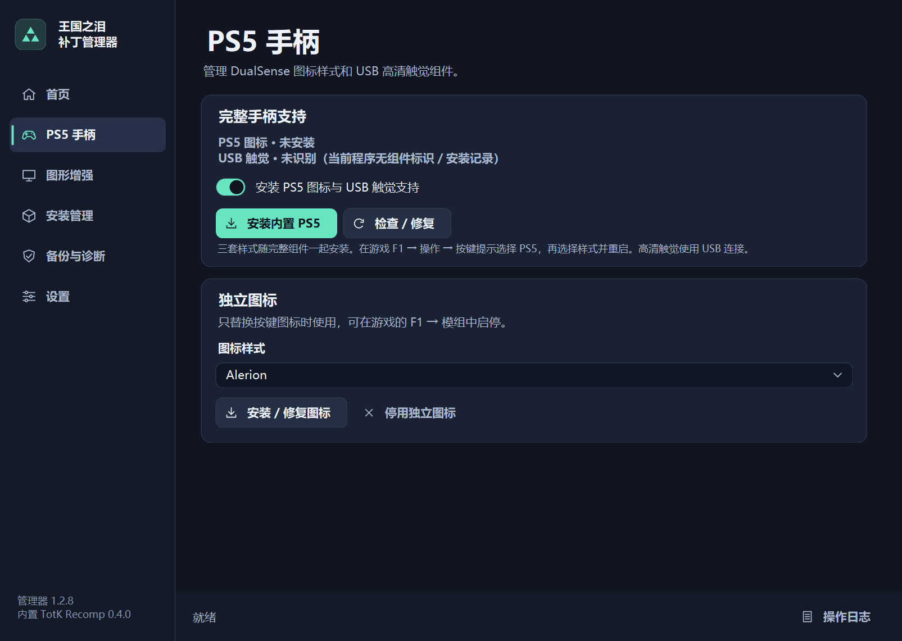

# 王国之泪补丁管理器 · TotK Patch Manager

用于 Windows 版 TotK Recomp 的社区补丁管理器。**v1.2.8 为源码发行版**，以已交付的 1.2.7 为稳定基线，面向 TotK Recomp **0.4.0** 和用户自备的游戏资源 **1.4.3**。

## 功能

- 管理 PS5 图标、DualSense USB 触觉、图形增强或整合组件。三套提示样式为 **Stellarznith、Stavaas、Alerion**。1.2.8 为它们加入 15 种官方宽屏尺寸的布局支持。
- 保留上游 F1 菜单的 DLSS／DLAA、模式和模型，恢复手动选择 **DLSS 模型 M**。独立的帧生成选项提供关闭、NVIDIA DLSS、AMD FSR。上游的 AMD FSR 1 空间放大仍在「放大到窗口」中。
- 支持版本检测、防降级、组件安装与修复、独立图标、备份回滚、安全启动、着色器预热、HDR／SDR 排查和日志导出。
- 本地完整构建可使用 x86-64-v2／v3 两档与 PS5／图形／整合三种组件组合。免编译入口依赖同版本本地预编译文件及资产清单。

## 安装与使用

1. 按[构建说明](docs/build.md)准备 Windows、Python 3.14 x64、本地固定上游源码和编译器，构建管理器。
2. 通过上游工具用自己的游戏资源建立 1.4.3 安装。若持有经核验的本地 1.2.8 完整构建，可通过 `--local-payload` 接入私有资产和六种预编译组合。
3. 启动管理器并选择该安装的 `totk.exe`。按需选择 PS5、图形或整合组件。装好后在游戏 F1 中设置按键提示、超分和帧生成，遇到启动问题可在「备份与诊断」回退。

源码包提供管理器、运行时扩展、构建工具和回归测试。完整安装需要本地提供游戏数据、对应 PS5 资源和厂商组件。公开下载仅含源码。

## English

TotK Patch Manager is an independent Windows companion for TotK Recomp. The **v1.2.8 source release** targets TotK Recomp **0.4.0** with user-provided **1.4.3** game resources.

- Manage three PS5 prompt styles (Stellarznith, Stavaas and Alerion), DualSense USB haptics, DLSS/DLAA, FSR scaling, and separate NVIDIA DLSS or AMD FSR frame generation.
- v1.2.8 restores manual DLSS model M and adds matching PS5 prompt layouts for 15 supported non-16:9 resolutions.
- The manager includes install/repair and rollback, standalone icon installation, version protection, safe launch and diagnostics. Six local prebuilt combinations cover two CPU tiers and three feature sets.

Build the WinForms manager and runtime recipe using the [Windows build guide](docs/build.md). Set up your own game dump with upstream, then select your local `totk.exe` in the manager. Full installation needs the matching local payload. This source archive contains no game runtime binaries, ROM data, mod artwork, fonts or vendor DLLs. See the [FAQ](docs/faq.md) and [release audit](docs/release-audit.md) for scope and test coverage.

Original code is licensed under [MIT](LICENSE). The retained upstream and SDK notices are listed in [third-party notices](THIRD_PARTY_NOTICES.md). The project is independent of Nintendo, Sony, NVIDIA, AMD and the upstream maintainers.
